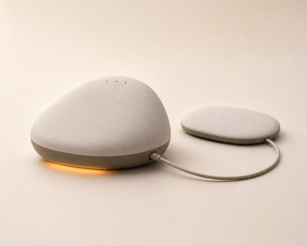
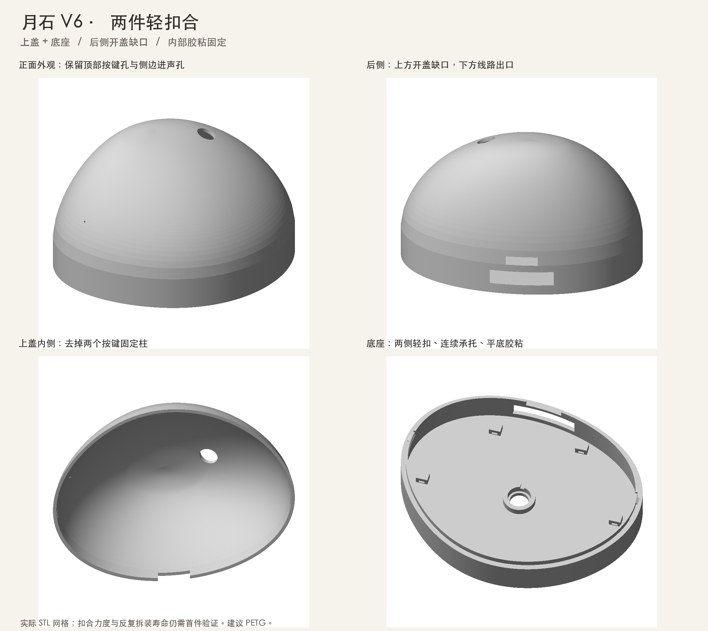
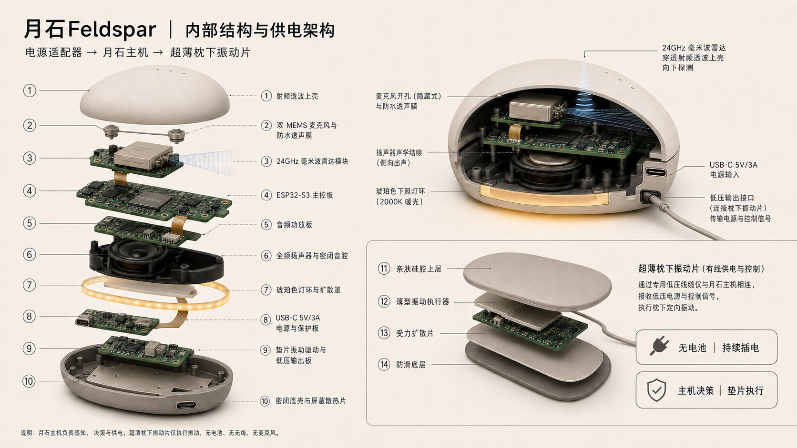
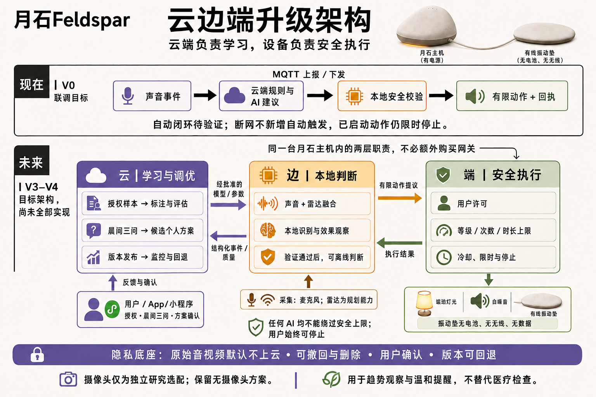

# 月石 Feldspar



*月石产品概念图*

## 项目背景

月石面向受夜间鼾声困扰的成年人和同睡伴侣。这个项目从一个家庭场景出发：睡前能看清设备是否就绪，夜里可以随时停止提醒，第二天能回看有记录的声音变化。

## 产品介绍

- **床头主机**以 ESP32-S3 为核心，在设备上提取声音的结构化特征，提供灯光、声音和有线振动控制。实体按键可长按停止全部输出。
- **枕下振动模块**通过有线方式连接主机。工程版提供手动试振和停止。
- **微信小程序**提供蓝牙配网、手动控制和睡眠记录。后端校验声学特征，并保存设备状态与命令回执。

当前公开的是 **V6 工程样机**。固件默认关闭自动提醒，v5 鼾声分类模型处于独立研究阶段。 [项目介绍](docs/PROJECT.md) · [参赛项目说明 PDF](docs/PROJECT.pdf) · [下载鼾声模型训练报告](https://github.com/Evan0825/feldspar/releases/download/v6-prototype/snoring-model-training-report.html)

## 结构与架构

**V6 外壳结构**采用上盖与底座两件式设计，两侧卡扣闭合，从后侧缺口抬开。 [CAD、打印与装配](hardware/v6/README.md)



**结构爆炸图**展示早期方案的主机、内部模块与枕下振动片布局。



**技术架构图**记录早期的云端学习、本地判断与设备执行规划。当前实现以[接口与行为说明](docs/DEVELOPMENT_CONTRACT.md)为准。



[项目图文资料与宣传海报](docs/materials/README.md)

## 复现入口

| 模块 | 源码 |
| --- | --- |
| V6 硬件 | [CAD](hardware/v6/cad/) · [STL](hardware/v6/stl/) · [接线](hardware/v6/WIRING.md) |
| ESP32-S3 固件 | [firmware/](firmware/) |
| 微信原生小程序 | [firmware/miniprogram-latest/](firmware/miniprogram-latest/) |
| Python 后端 | [backend/](backend/) |

## 本地运行

使用 Python 3.12、Node.js 22 和 Clang，在仓库根目录运行。

```sh
git clone --branch v6-prototype https://github.com/Evan0825/feldspar.git
cd feldspar
python3.12 -m venv .venv
.venv/bin/python tests/run_checks.py
.venv/bin/python -m pip install -r backend/requirements.lock.txt
.venv/bin/python -m unittest discover -s backend/tests -v
.venv/bin/python scripts/smoke_backend.py
```

- 小程序使用微信开发者工具导入，默认以 Mock 模式启动。
- 固件使用 ESP-IDF 5.4.1 构建，自动提醒默认关闭。
- 后端支持 SQLite 离线验证。启动 API、测试设备和真实环境配置见[软件复现](docs/REPRODUCE.md)。

## 许可

自研软件采用 [Apache-2.0](LICENSE)，V6 自研硬件采用 [CERN-OHL-P-2.0](hardware/v6/LICENSE)，两者均允许按条款商用。项目补充图文采用 [CC BY-NC 4.0](docs/materials/LICENSE)，商用须另行授权。第三方内容沿用各自许可。 [第三方说明](THIRD_PARTY_NOTICES.md) · [贡献指南](CONTRIBUTING.md)
