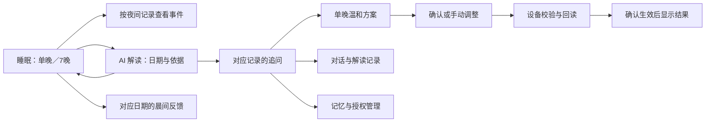

# 月石 AI 与睡眠数据交互检查

日期：2026-10-28。对象：本地原生小程序 21 页；同时核对 GitHub 集成版 19 页的相关实现。实屏来自本次检查中的微信开发者工具 Stable 2.02.2608060、iPhone 12/13 (Pro)、Mock 模式，不复用先前审查截图。

结论：主路径可用，发现的日期错配、反馈定位／草稿和缺失数据展示已修正并补回归。真实集成版历史 7 晚完整回看仍是能力缺口，不能作为全产品实机验收通过。

## 页面职责与主交互

「月石」承担当晚准备与控制；「睡眠」承担记录、事件、趋势与反馈；「AI」承担解读、证据、追问与建议；「我的」承担偏好、设备和授权。AI 记忆不覆盖个人偏好，建议不等于设备已应用。

| 步骤 | 用户操作 | 当前健康状况 |
| --- | --- | --- |
| 1 | 在睡眠页切换单晚／7晚，确认日期与质量 | 已核对；「昨夜」改为「单晚」，避免旧记录被误认作昨夜 |
| 2 | 查看同一晚的事件并筛选响应 | 已修正：请求传递报告 nightId，显示对应日期 |
| 3 | 打开 AI 解读，展开判断依据，再看原睡眠记录 | 演示版可用；集成版按夜查询，缺失时明确不可用 |
| 4 | 继续追问或从 AI 首页直接提问，查看与复制回答 | 已核对；上下文日期、来源、保存状态可见；7晚推荐问题专注趋势 |
| 5 | 从单晚回答查看建议，对比参数，确认／取消或手动调整 | 已核对取消与返回；未修改参数时保存禁用；实机回读尚未验收 |
| 6 | 填写对应日期的晨间反馈 | 已修正：入口定位问题区，同晚未提交内容刷新后保留，换夜清空 |
| 7 | 从记录恢复对话，从记忆页管理授权 | 已核对；对话与记忆分开；授权入口直达展开区 |
| 8 | 返回首页与其他设置、配网、自检、首夜准备 | 21 页均有本轮截图；高影响操作保持未执行，见逐页表 |

## 已修复的问题

1. **P1：集成版历史 AI 解读返回最新睡眠记录。** 原实现只切换到底部睡眠页，没有传递来源；现在按原 nightId 查询，并核对返回记录 ID。原记录缺失、无日期或周期接口不支持时明确提示不可用，保留显式「查看最新记录」入口，不偷偷替换成其他日期。证据：源码与新增集成回归；演示版对应日期回看实屏 `05-source-record.png`。
2. **P1：集成版周视图在 AI 刷新间隙可能打开单晚解读。** 基础报告先返回时曾把单晚解读设为当前点击目标；现在周视图等周期解读就绪后才开放该目标，旧周期解读同时清空。新增测试已先复现再修复。
3. **P2：晨间反馈绕路且缺少日期。** 数据页进入反馈时定位到问题区域，标题附实际记录日期；问题改为「这晚是否被弄醒」。实屏 `14-feedback-focused.png`。长页面仍可滚动查看趋势和底部按钮。
4. **P2：同晚未提交反馈被刷新清空。** 保留当前页面同一夜晚的修改；记录换夜则重置。提交绑定开始操作时的 nightId，旧夜回执不写进新夜表单。两版均有回归覆盖；没有提交虚构晨间反馈。
5. **P2：AI 适配层补造缺失事实。** 取消用当前日期推算未知周报周期、用当前时间补生成时间、默认「良好」、以证据文字长度生成数值。缺失显示未提供／未评估／来源未标注，只有真实提供的字段才展示。证据为适配器测试，不能由 Mock 截图代替。
6. **P3：7晚对话仍引导今晚单晚参数设置。** 推荐问题改为趋势与依据，单晚继续保留设置问题；新实屏 `ai-chat.png`。首页报告入口改为功能动作「查看睡眠记录」；AI 不可用时取消报告卡上的无效箭头。

## 仍需补齐与可优化项

- **P2，集成版历史 7 晚完整数据回看：** 当前后端周报接口只提供当前 days 窗口，没有指定历史起止日参数。现在会明确提示所选记录不可用；原 AI 解读仍可查看。下一步需要后端按 periodStart／periodEnd 查询并保持原周期。
- **P2，两版 AI 信息结构不同：** 演示版有独立对话记录／记忆页面，集成版沿用页内记录模式。此次对相关日期、参数与错误展示分别修复；不能把演示版截图当作集成版完整一致的交付证据。下一版应收敛到一套路由与服务契约。
- **P3，历史对话的周期辨识：** 7晚对话列表目前主要显示来源结束日，完整周期在进入对话后可见；列表可补周期类型／范围。参见 `10-ai-records.png`。
- **P3，7晚主图的缺失日说明：** 灰色短柱可见，但图例弱于独立趋势页；建议统一缺失状态图例，避免看成 0 次。参见 `06-sleep-week.png`。
- **P3，规则演示回答偏长：** 多条依据拼接会重复日期；建议回答先给简短结论，将详细数据保留在「查看判断依据」。参见 `09-week-answer.png`。未在本轮擅自删减分析内容。

## 无障碍与证据边界

实屏中字号、输入区、关键主操作可见，反馈按钮可到达安全区上方，错误和离线说明未仅靠颜色表达。模拟器 AX 中部分筛选、同睡选择仍主要表现为文本；选中态语义、动态回答朗读、错误焦点、44px 触控体验与大字体重排需真实手机读屏验证，本轮不宣称 WCAG 完整合规。

本轮没有发送配网密码、执行解绑／删除对话／固件更新、接受新的真实授权、应用硬件输出或上传生产版本。仅在明确 Mock 模式中点击蓝牙下一步、提交两条预设 AI 问题并查看本机保存结果；方案确认已取消。

快速切换临时编译模式时曾出现一次基础库 `routeDone with a webviewId ... is not found`，单页完整重编译后未复现；已记录为检查环境限制。最终正常主路径显示 0 个调试错误；开发者工具预加载／worker 提示另计。临时编译模式已清理。

## 逐页检查清单

| 路由 | 页面 | 检查内容 | 结果／边界 | 本轮实屏 |
| --- | --- | --- | --- | --- |
| onboarding | 个人设置／登录 | 称呼、同睡情况、提醒方案；固定振动无取消控件。登录另有截图。 | 可用，登录授权未提交 | [00-start.png](../validation/ui-interaction-20261028/00-start.png) |
| home | 月石 | 查看方案、声音／夜灯、AI、实时状态、睡眠记录入口。 | 已核对；睡眠入口不再误称昨夜 | [12-home-final.png](../validation/ui-interaction-20261028/12-home-final.png) |
| strategy | 温和方案 | 四阶段、观察方式、提醒限制与参数展开。 | 已核对；七日不自动升级 | [strategy.png](../validation/ui-interaction-20261028/strategy.png) |
| report | 睡眠数据 | 单晚／7晚；夜间详情、反馈、AI 解读；来源记录按日期锁定。 | 已修正范围切换与日期绑定 | [13-sleep-final.png](../validation/ui-interaction-20261028/13-sleep-final.png) |
| ai | AI 首页 | 推荐问题直接进入对应单晚对话；记录与记忆为独立入口。 | 已核对 | [15-ai-home.png](../validation/ui-interaction-20261028/15-ai-home.png) |
| trends | 趋势与反馈 | 由数据页进入时定位到反馈；明确对应日期；同晚草稿保留。 | 已修正并实屏复核 | [14-feedback-focused.png](../validation/ui-interaction-20261028/14-feedback-focused.png) |
| profile | 我的／授权 | 记忆管理跳转后直接展开 AI 授权区；用户可管理记忆与对话。 | 已核对；未撤销真实授权 | [17-authorization.png](../validation/ui-interaction-20261028/17-authorization.png) |
| setup | 添加设备 | 发现设备、模拟蓝牙连接、Wi-Fi 字段、密码用途。 | 表单可达；未发送密码或绑定 | [setup-wifi.png](../validation/ui-interaction-20261028/setup-wifi.png) |
| calibration | 设备自检 | 检查、就绪、调整今晚设置、完成准备。 | 单独完整编译复核通过 | [calibration.png](../validation/ui-interaction-20261028/calibration.png) |
| readiness | 首夜准备 | 设备放置、当前参数与开始记录。 | 已核对；未启动实机记录 | [readiness.png](../validation/ui-interaction-20261028/readiness.png) |
| device | 设备详情 | 连接、传感器、模型／固件状态与更新说明。 | 已核对；未执行更新 | [device.png](../validation/ui-interaction-20261028/device.png) |
| tonight | 今晚设置 | 同睡情况、灵敏度、振动上限、保护期和次数。 | 已核对；未发送实机设置 | [tonight.png](../validation/ui-interaction-20261028/tonight.png) |
| sound | 声音 | 播放、场景、音量、定时；手机试听演示标注。 | 页面可用；实机音频未验收 | [sound.png](../validation/ui-interaction-20261028/sound.png) |
| light | 夜灯 | 灯效、亮度、开关；当前操作明确。 | 页面可用；实机灯效未验收 | [light.png](../validation/ui-interaction-20261028/light.png) |
| events | 夜间事件 | 沿所选报告 nightId 获取事件，显示日期；响应筛选可用。 | 已修正并实屏复核 | [events.png](../validation/ui-interaction-20261028/events.png) |
| live | 实时状态 | 快照时刻、观察状态、次数、最近动态、提醒设置与返回。 | 已核对；真实延迟／停止需实机 | [live.png](../validation/ui-interaction-20261028/live.png) |
| ai-detail | AI 解读详情 | 结论、来源日期、质量、展开依据、追问、原睡眠记录。 | 演示版可用；集成版历史周报受限 | [04-ai-detail.png](../validation/ui-interaction-20261028/04-ai-detail.png) |
| ai-chat | AI 对话 | 单晚带日期追问、查看依据、建议、复制、保存、历史与新建。 | 主路径可用；7晚问题已按趋势调整 | [18-single-chat-response.png](../validation/ui-interaction-20261028/18-single-chat-response.png) |
| ai-plan | 今晚温和方案 | 参数差异、推荐／手动、确认／取消与设备回读。 | 确认可取消；未应用设备输出 | [19-chat-to-plan.png](../validation/ui-interaction-20261028/19-chat-to-plan.png) |
| ai-records | AI 记录 | 对话／解读分类、日期来源、继续、删除确认。 | 已核对；未删除对话 | [10-ai-records.png](../validation/ui-interaction-20261028/10-ai-records.png) |
| ai-memory | AI 记忆 | 记忆开关、同睡资料、授权入口；与设备设置分开。 | 已核对；真实读屏需补测 | [16-ai-memory.png](../validation/ui-interaction-20261028/16-ai-memory.png) |

## 自动验证

- 演示版 `npm run test:miniprogram`：367 项通过；21 路由结构检查通过，主包约 1584.6 KiB。
- 集成版 `python3 tests/run_checks.py`：原生 C 离线检查与 41 项 Node 回归通过；包括来源日期、事件范围、周视图点击目标、反馈定位与草稿、AI 缺失字段。
- 已先用新增回归复现日期错配、反馈和周视图问题，再验证修复；日志见验证目录。
- 生产云端／BLE／硬件回读未在本轮实测。后端代码未改动；后端与集成冒烟检查由同 PR 的 CI 再运行。
