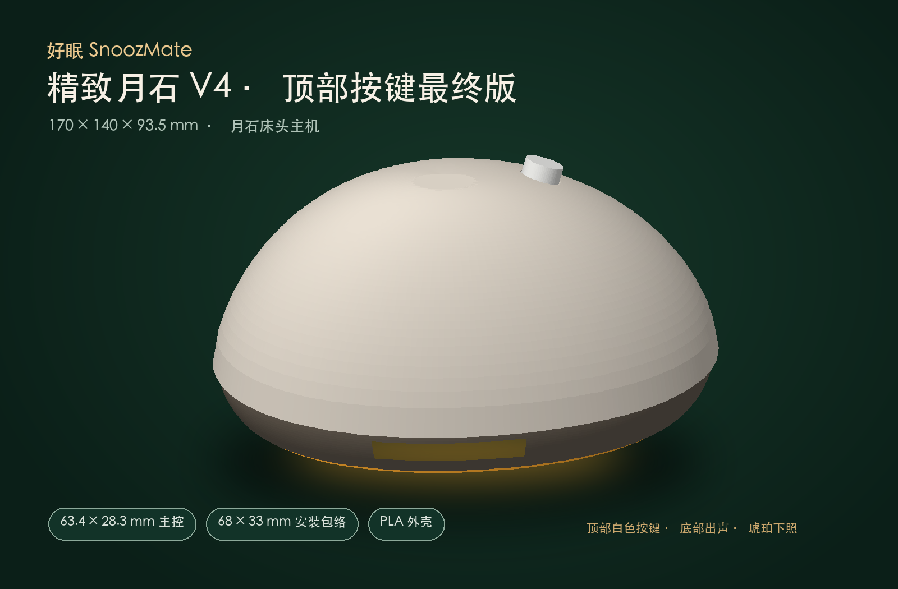

# 月石 V4 工程样机

V4 是顶部白色按键、底部柔光环和独立有线枕下振动模块的打印方案。主机外廓约 170 × 140 × 93.5 mm，枕下外壳约 75 × 55 × 14 mm。



| 资料 | 入口 |
| --- | --- |
| 结构与制造 | [可编辑 Python CAD](cad/) · [8 个打印 STL](stl/) · [打印与装配](ASSEMBLY.md) · [公差表](tolerances.csv) |
| 枕下模块 | [设计规格](HAPTIC.md) · [结构预览](reference/haptic.png) |
| 接线与物料 | [模块接线与选型](WIRING.md) |
| 配套软件 | [ESP32-S3 固件](../../firmware/) · [微信小程序](../../firmware/miniprogram-latest/) · [Python 后端](../../backend/) · [软件复现](../../docs/REPRODUCE.md) |
| 证据 | [STL 网格检查记录](validation.json) · [既有样机联调记录](../../validation/20261107-hardware-bringup/README.md) |

STL 的单位为毫米，按 100% 比例导入。先用按键试孔片和实际部件核对尺寸。[`reference/`](reference/) 的两个 STL 仅供预览。

## 从 CAD 重建

在仓库根目录运行以下命令。生成文件放在当前目录下的 `outputs/`，与版本中随附的 `stl/` 分开。

```sh
python3.12 -m venv .venv
.venv/bin/python -m pip install -r hardware/v4/cad/requirements.txt
.venv/bin/python hardware/v4/cad/generate_models.py --variant refined_v4_final
.venv/bin/python hardware/v4/cad/validate_models.py \
  outputs/20260901-snoozmate-moonstone-cad/stl-refined-v4-final 8
```

发布时重建的 8 个打印件与随附 STL 逐字节一致，并通过尺寸和闭合网格检查。实际模块型号、针序、上盖配合、温升和物理停止时间仍需在复刻样机上核验。既有样机联调记录按当时实际固件版本记载，不能代替本 V4 结构和配套软件装好后的整机复验。现有资料覆盖模块级接线和装配，完整 PCB 工程、整机原理图和量产 BOM 暂无公开文件。

## 许可

本目录的 V4 CAD、STL 和自研硬件资料采用 [CERN-OHL-P-2.0](LICENSE)，允许按条款制造、修改、销售和再分发。随产品提供适用的 [声明](NOTICE)。配套固件、小程序、后端和相关自研软件仍采用 [Apache-2.0](../../LICENSE)。第三方模块沿用各自许可，品牌和标识的使用权需另行取得。
