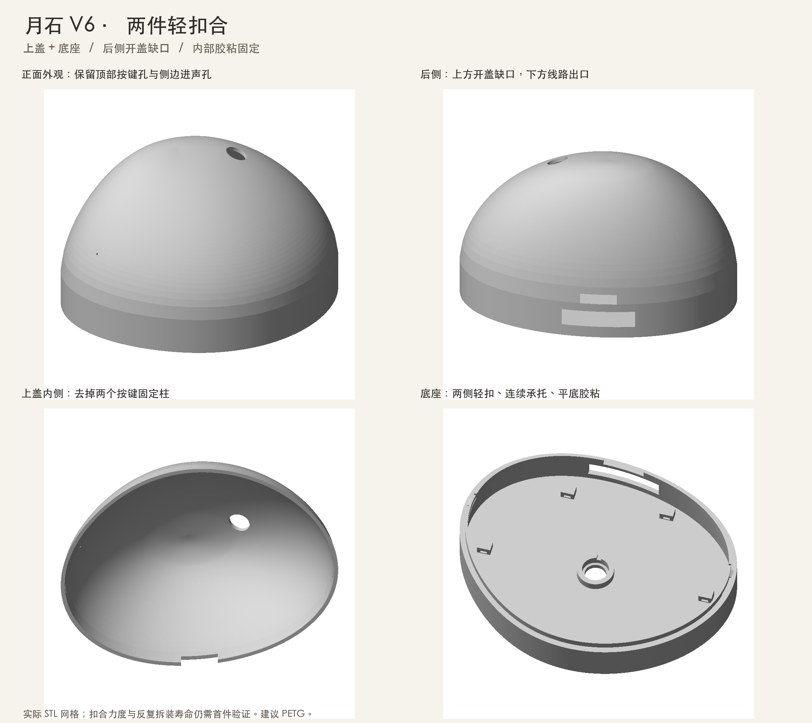

# 月石 V6 工程样机

床头主机由上盖和底座两件组成。两侧隐藏卡扣合盖，从后侧缺口抬开。整机外廓约 167 × 137 × 98.5 mm。



| 资料 | 内容 |
| --- | --- |
| [打印文件](stl/) | 上盖、底座各一个 STL，单位为毫米 |
| [打印与装配](ASSEMBLY.md) | 切片方向、卡扣清理、模块固定、开合步骤 |
| [接线与物料](WIRING.md) | 模块选型、ESP32-S3 引脚和供电 |
| [CAD 源码](cad/) | 上盖参考曲面、参数化结构和几何检查 |
| [配套软件](../../docs/REPRODUCE.md) | 固件构建、小程序导入、后端离线运行 |

## 重建和验证

在仓库根目录运行。工具会在输出目录写入两个 STL 和验证报告。

```sh
python3.12 -m venv .venv
.venv/bin/python -m pip install -r hardware/v6/cad/requirements.txt
.venv/bin/python hardware/v6/cad/build.py --output build/v6
```

[验证报告](validation.json)记录两个网格的尺寸、闭合性和 SHA-256，以及合盖干涉、卡扣开合路径、安装空间和开孔检查。发布时重建的两个 STL 与下载文件逐字节一致。首次打印后按装配说明复核卡扣力度和拆装手感。

## 许可

V6 CAD、STL 和自研硬件资料采用 [CERN-OHL-P-2.0](LICENSE)，可按条款制造、修改、销售和再分发。随产品提供适用的[声明](NOTICE)。配套固件、小程序和后端采用 [Apache-2.0](../../LICENSE)。
